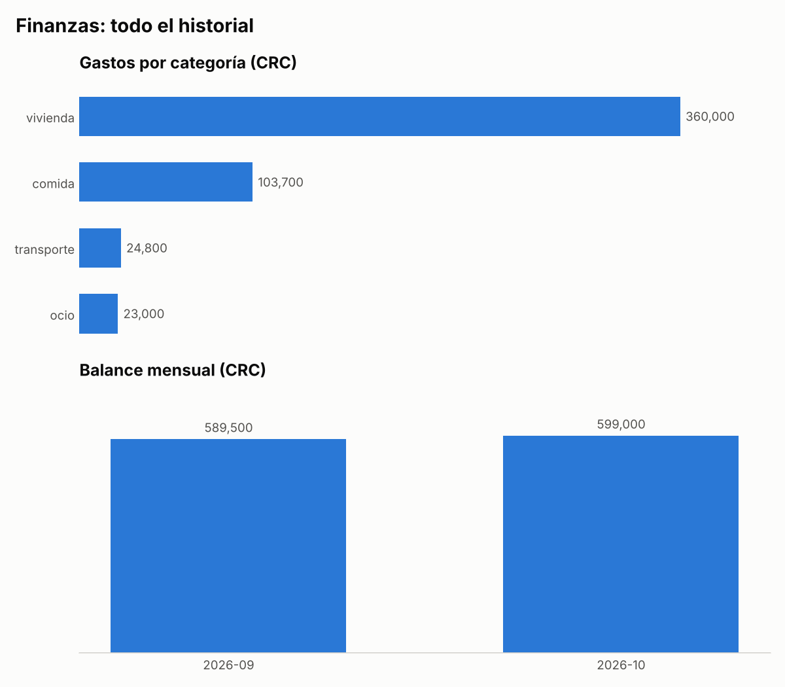

#  finanzas-cli


Herramienta de línea de comandos para llevar el control de tus finanzas personales:
registra ingresos y gastos en colones, dólares o euros, define presupuestos y metas de
ahorro, y analiza tus hábitos con reportes, proyecciones y detección de gastos inusuales.

**Núcleo sin dependencias externas**: solo la biblioteca estándar de Python (`sqlite3`,
`argparse`, `csv`, `decimal`, `statistics`). Los gráficos PNG usan matplotlib como extra opcional.

```
$ finanzas analisis
Análisis 2026-10

Comparado con 2026-09
  comida           138,000.00  vs    40,000.00   ▲ 245.0%
  transporte        11,000.00  vs    12,000.00   ▼ 8.3%
  TOTAL            149,000.00  vs    52,000.00

Proyección al cierre del mes (día 20 de 31)
  Gasto proyectado: 230,950.00
  ⚠ comida: a este ritmo llegarás a 213,900.00 (presupuesto 120,000.00)

Gastos inusuales
  #10 2026-10-12 comida            95,000.00  (2.4x el promedio de 40,000.00)
```

##  Funcionalidades

- **Registro de movimientos** con categoría, descripción, fecha y moneda.
- **Multimoneda (CRC, USD, EUR)**: cada movimiento guarda su moneda original y los reportes
  convierten a colones con el tipo de cambio que configures.
- **Presupuestos mensuales** por categoría, con alertas cuando se exceden.
- **Metas de ahorro** con barra de progreso y cálculo de cuánto ahorrar por mes para llegar a tiempo.
- **Análisis**: comparación con el mes anterior, proyección del gasto al cierre del mes y
  detección de gastos inusuales por categoría.
- **Reportes** en la terminal y **gráficos PNG** exportables.
- **Importación/exportación CSV**. La importación es *atómica*: si una fila es inválida, no se
  guarda nada y se indica la línea exacta del error.
- **Precisión monetaria**: montos en centavos enteros y tipos de cambio en `Decimal`, nunca `float`.
- **Migración automática**: las bases de datos de la versión 1.0 se actualizan solas al abrirlas.

##  Instalación

```bash
git clone https://github.com/DavidBrenes1/finanzas-cli.git
cd finanzas-cli
python -m venv .venv && source .venv/bin/activate   # Windows: .venv\Scripts\activate
pip install -e .              # núcleo, sin dependencias
pip install -e ".[graficos]"  # opcional: exportar gráficos PNG
```

##  Uso

```bash
# Registrar movimientos (fecha por defecto: hoy; moneda por defecto: CRC)
finanzas ingreso 850000 salario -d "Salario octubre"
finanzas gasto 42500.50 comida -d "Supermercado" -f 2026-10-05
finanzas gasto 15.99 ocio -M USD -d "Netflix"

# Tipos de cambio (colones por 1 unidad)
finanzas cambio USD 505.50
finanzas cambio                    # ver los configurados

# Consultar y analizar
finanzas listar -m 2026-10 -c comida
finanzas reporte -m 2026-10
finanzas analisis                  # mes actual vs. anterior, proyección e inusuales
finanzas grafico reporte.png       # requiere el extra [graficos]

# Presupuestos
finanzas presupuesto comida 80000
finanzas presupuesto               # estado del mes actual

# Metas de ahorro
finanzas meta crear viaje 600000 -f 2027-06-30
finanzas meta aportar viaje 150000
finanzas meta retirar viaje 20000
finanzas meta                      # ver progreso

# Datos
finanzas importar docs/ejemplo.csv
finanzas exportar respaldo.csv
finanzas eliminar 7
```

```
$ finanzas meta
Metas de ahorro
  viaje          █████░░░░░░░░░░░░░░░  25.0%  150,000.00 / 600,000.00  ahorra 50,000.00/mes hasta 2027-06-30
  emergencias    ██████░░░░░░░░░░░░░░  32.0%  320,000.00 / 1,000,000.00  faltan 680,000.00
```

```
$ finanzas grafico reporte.png
```



Los datos se guardan en `~/.finanzas.db`. Puedes cambiar la ruta con `--db ruta.db`
o con la variable de entorno `FINANZAS_DB`.

### Formato CSV

La columna `moneda` es opcional; si falta o está vacía se usa CRC.

```csv
fecha,tipo,monto,categoria,descripcion,moneda
2026-10-01,ingreso,850000,salario,Salario octubre,CRC
2026-10-10,gasto,15.99,ocio,Netflix,USD
```

##  Arquitectura

```
src/finanzas/
├── models.py     # Dominio: Transaccion, Meta, Tipo, validación de montos y monedas
├── storage.py    # Persistencia: Repositorio sobre SQLite, migraciones e import/export CSV
├── monedas.py    # Conversión a la moneda base con Decimal
├── reports.py    # Resumen, categorías, balance mensual, presupuestos (funciones puras)
├── analisis.py   # Comparación entre meses, proyección y gastos inusuales (funciones puras)
├── metas.py      # Progreso de metas y ahorro mensual necesario (funciones puras)
├── graficos.py   # Exportación PNG con matplotlib (importación tardía, opcional)
└── cli.py        # Interfaz: parseo de argumentos y presentación
```

El código sigue una **arquitectura en capas**. La CLI orquesta el repositorio y los módulos
de cálculo, y estos últimos son funciones puras que no saben nada de la base de datos ni de
la terminal. Así se pueden probar de forma aislada y reutilizar, por ejemplo en una API web.
Más detalles en [docs/ARQUITECTURA.md](docs/ARQUITECTURA.md).

##  Pruebas

```bash
pip install -e ".[dev,graficos]"
pytest          # 85 pruebas + doctests, con reporte de cobertura
ruff check .    # linter
```

La integración continua (GitHub Actions) ejecuta el linter y las pruebas en Python 3.10 a 3.13
en cada *push*. Los cambios de cada versión están en [CHANGELOG.md](CHANGELOG.md).

##  Hoja de ruta

###  v1.1 — Análisis y multimoneda (actual)
- [x] Soporte multimoneda (CRC, USD, EUR) con tipo de cambio configurable
- [x] Metas de ahorro con seguimiento de progreso
- [x] Comparación entre meses
- [x] Proyección de fin de mes según el ritmo de gasto actual
- [x] Detección de gastos inusuales
- [x] Exportar reportes a PNG con matplotlib

### v1.2 — Funcionalidad básica ampliada
- [ ] Editar transacciones existentes (`finanzas editar 7 --monto 15000`)
- [ ] Transacciones recurrentes (salario, alquiler, suscripciones) generadas automáticamente cada mes
- [ ] Búsqueda por texto en descripciones
- [ ] Subcategorías (`comida/restaurantes`, `comida/supermercado`)

### v1.3 — Datos e interfaz
- [ ] Interfaz de terminal interactiva (TUI) con Textual
- [ ] Importar estados de cuenta bancarios en CSV con mapeo de columnas configurable
- [ ] Categorización automática por reglas (p. ej. "Uber" → transporte)
- [ ] Reporte mensual en PDF

### v2.0 — Plataforma
- [ ] API REST con FastAPI reutilizando las capas existentes
- [ ] Dashboard web
- [ ] Soporte para varios usuarios con autenticación
- [ ] Migración opcional a PostgreSQL mediante el patrón Repository
- [ ] Imagen Docker y despliegue en la nube

##  Licencia

MIT © 2026 David Brenes
